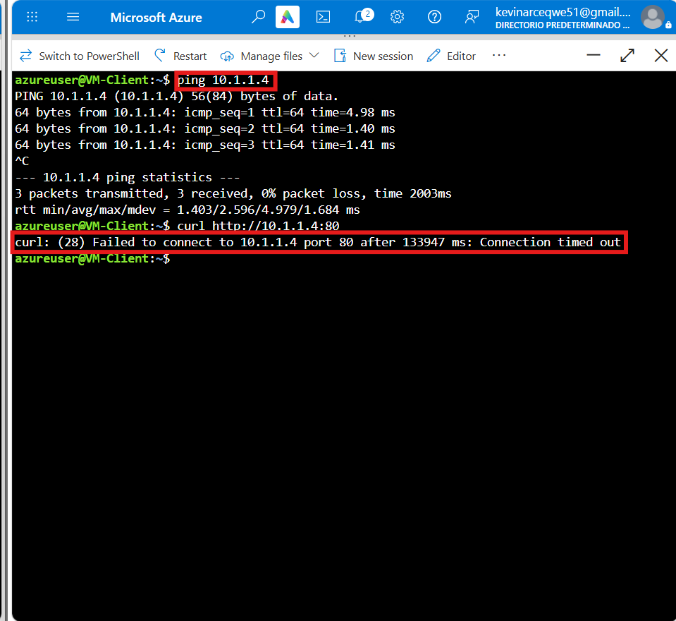
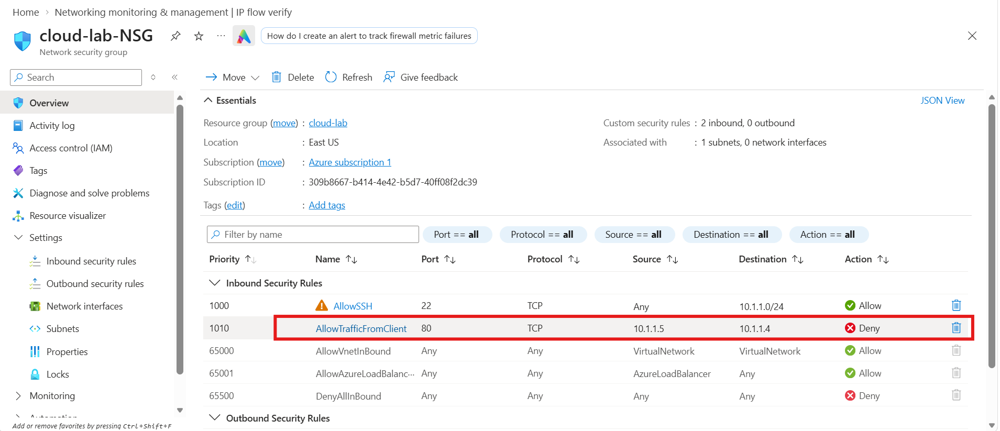
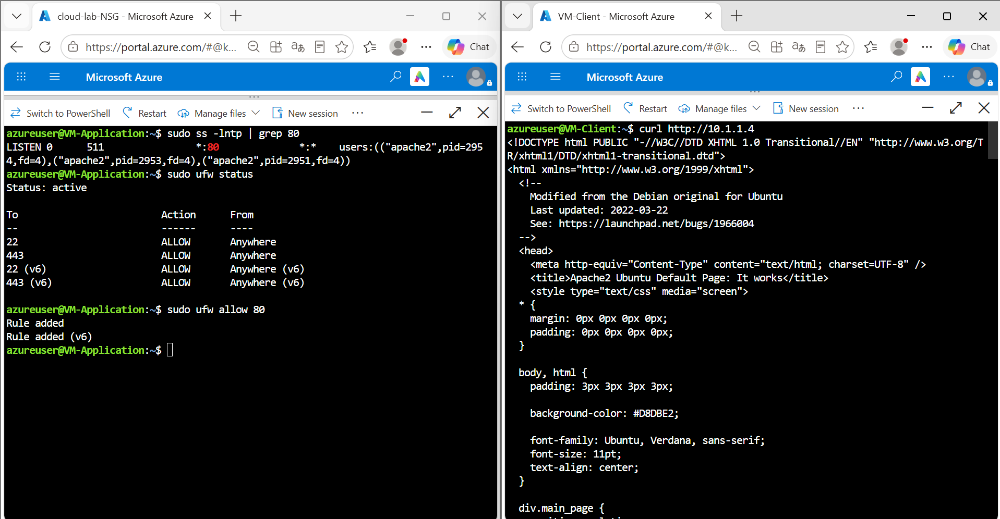

\# Ticket 01: HTTP Connectivity Failure Between Azure VMs

\*Area:\* Networking / Linux | \*Services:\* Azure VMs, NSG, Ubuntu Firewall (UFW), Apache

\---

\## Symptom

A client VM could ping the web server VM, but HTTP requests using curl failed with a connection timeout.

\## Diagnosis

1\. Ran ping from the client VM → Successful. This ruled out the VM being down or a routing issue, so the problem was at the port level.

2\. Ran curl to the web server → Connection timed out.

3\. Inspected the NSG rules → Found a rule blocking inbound TCP traffic on port 80 from the client VM.

4\. Ran ss -lntp | grep 80 on the web server → Apache was listening on port 80, so the service itself was healthy.

5\. Checked UFW on the web server → Inbound TCP traffic on port 80 was not allowed.

\## Root Cause

Two independent firewalls were blocking HTTP traffic:

\- \*Azure NSG:\* An inbound rule blocked TCP port 80 from the client VM.

\- \*Ubuntu UFW:\* The OS firewall also denied inbound traffic on port 80.

\## Resolution

1\. Updated the NSG to allow inbound TCP port 80 from the client VM.

2\. Added a UFW rule to allow inbound TCP port 80.

3\. Retested with curl from the client VM → The web server responded successfully.

\## Prevention

\- Validate connectivity at both layers (Azure network and OS) when setting up a VM.

\- Document the ports each application needs.

\- Review NSG and UFW rules regularly, following least privilege.

