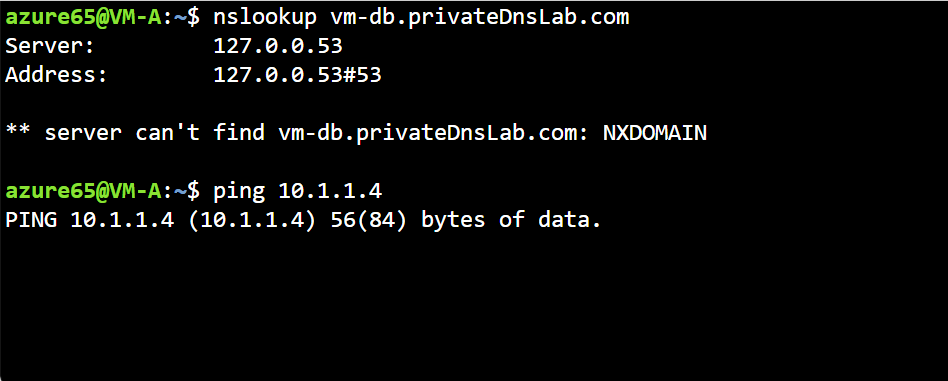
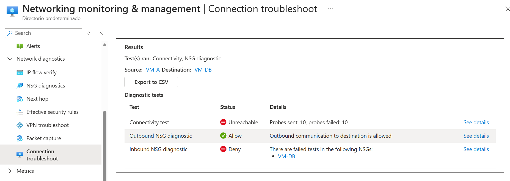
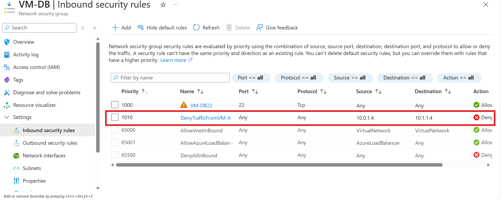

# Ticket 02: Private DNS Resolution and Network Connectivity Failure Between Azure VMs

\*\*Area:\*\* Networking / DNS

\*\*Services:\*\* Azure Virtual Machines, Azure Private DNS Zones, Virtual Network Links, Network Security Groups (NSG), Network Watcher

\---

## Symptom

VM-A could not resolve VM-DB using its Fully Qualified Domain Name (FQDN). Additionally, ICMP connectivity tests between both virtual machines failed.

### Initial Investigation

## Diagnosis

1. Tested DNS resolution using `nslookup` from VM-A → VM-DB FQDN could not be resolved.

2. Tested ICMP connectivity using `ping` → Requests to VM-DB failed.

3. Used Network Watcher Connection Troubleshoot → Identified an inbound NSG rule blocking traffic from VM-A to VM-DB.

4. Inspected the NSG configuration → Confirmed the inbound security rule responsible for blocking traffic.

5. Reviewed the Azure Private DNS Zone → Found that the VNet hosting VM-A was not linked to the private DNS zone.

### Network Watcher Investigation

### NSG Configuration

### Private DNS Configuration

## Root Cause

Two independent configuration issues affected connectivity:

- The VM-A Virtual Network was not linked to the Azure Private DNS Zone, preventing VM-A from resolving VM-DB through its FQDN.

- An inbound NSG security rule on VM-DB blocked the required traffic from VM-A.

## Solution

1. Added the VM-A Virtual Network as a Virtual Network Link to the Azure Private DNS Zone.

2. Reviewed the NSG configuration and corrected the inbound rule to allow the required traffic from VM-A.

3. Repeated DNS and connectivity tests to validate the changes.

## Validation

- DNS resolution using `nslookup`: Successful.

- ICMP connectivity using `ping`: Successful.

- VM-A successfully resolved and reached VM-DB.

## Prevention

- Maintain an inventory of Virtual Network Links associated with Private DNS Zones.

- Review NSG inbound and outbound security rules when deploying new workloads.

- Include DNS resolution and connectivity tests in infrastructure validation procedures.

- Document network dependencies between virtual networks.

